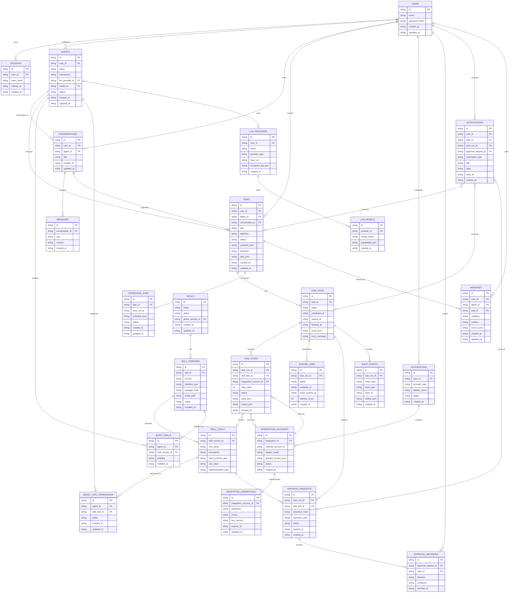

# Technical Specification Addendum

## 1. Repository Documentation

Create a dedicated `docs/` directory at the repository root.

All documentation, diagrams, API specifications, comments, identifiers, and source code must be written in English.

The documentation must be maintained alongside the implementation. Whenever a database migration, API endpoint, skill format, or significant architectural behavior changes, update the corresponding documentation.

### Required documentation structure

```text
docs/
├── README.md
├── architecture/
│   ├── overview.md
│   ├── application-lifecycle.md
│   ├── agent-runtime.md
│   ├── scheduling.md
│   ├── security-model.md
│   └── workspace.md
├── database/
│   ├── README.md
│   ├── er-diagram.md
│   ├── data-dictionary.md
│   └── migrations.md
├── api/
│   ├── README.md
│   ├── openapi.yaml
│   ├── authentication.md
│   ├── agents.md
│   ├── tasks.md
│   ├── integrations.md
│   ├── approvals.md
│   ├── skills.md
│   ├── notifications.md
│   └── websocket.md
├── skills/
│   ├── README.md
│   ├── package-format.md
│   ├── manifest-schema.json
│   ├── installation-lifecycle.md
│   ├── permissions.md
│   └── authoring-guide.md
├── deployment/
│   ├── docker.md
│   ├── configuration.md
│   ├── backup-and-restore.md
│   └── reverse-proxy.md
└── development/
    ├── setup.md
    ├── testing.md
    └── contributing.md
```

The directory structure may evolve, but all required documentation must remain present.

### Documentation requirements

- `docs/README.md` must serve as the documentation index.
- `docs/database/er-diagram.md` must contain the authoritative Mermaid ER diagram.
- `docs/database/data-dictionary.md` must describe every table, column, foreign key, index, and important constraint.
- `docs/api/openapi.yaml` must describe the actual REST API, request schemas, response schemas, authentication requirements, and error responses.
- `docs/api/websocket.md` must document WebSocket authentication, event types, payloads, and reconnection behavior.
- `docs/skills/package-format.md` must define the ZIP format and installation rules.
- `docs/skills/permissions.md` must describe skill permissions and enforcement.
- `docs/architecture/security-model.md` must describe the trust boundaries and authorization model.

Use OpenAPI 3.1 or a compatible current version. Generate or validate the specification against the actual backend routes.

Do not maintain a separate, outdated list of endpoints manually when it can be derived or checked against the implemented API.

Mermaid diagrams must be stored as editable text in Markdown rather than only as rendered images.

---

# 2. Database Design

Use SQLite with SQLx and versioned SQL migrations.

Use UUIDs or another documented, stable identifier strategy for entities that need to be referenced by API clients.

Store timestamps in UTC using a consistent ISO 8601 representation or an explicitly documented integer representation.

Use foreign keys, indexes, unique constraints, and transactions.

Enable SQLite foreign-key enforcement and configure the database appropriately for concurrent readers and writers.

The schema must support the following concepts:

- A local user and authenticated sessions.
- Multiple agents.
- Conversations and messages.
- Persistent tasks and recurring schedules.
- Task executions and execution steps.
- A persistent job queue.
- LLM provider configurations.
- Multiple connections to external services.
- Installed skills and their declared tools.
- Tool permissions.
- Approval requests and decisions.
- Long-term memory.
- Notifications.
- Audit events.
- Application settings.

## 2.1. Mermaid ER Diagram

Create `docs/database/er-diagram.md` and include the following diagram.

The diagram represents the logical database model. Physical SQL types, indexes, constraints, and nullable fields must be defined in the migrations and data dictionary.



## 2.2. Database implementation rules

Treat the diagram as a logical overview, not as a substitute for detailed schema design.

The implementation must address the following requirements.

### Users and authentication

The initial product may support one local administrator, but the database should allow multiple users in the future.

Every user-owned resource must have a clear ownership relationship.

Sessions must store a token hash rather than a reusable plaintext session token.

### Agents and models

An agent may select an LLM provider and model independently of other agents.

Do not assume the model supports tool calling, structured output, or streaming. Store or discover model capabilities explicitly.

### Tasks and runs

A task represents the persistent user objective.

A task run represents one attempt to execute that objective.

A task may have many runs, while each run belongs to exactly one task.

Execution steps must preserve the order and results of tool calls.

### Scheduling and the job queue

A recurring task must have a persistent schedule.

A due schedule creates an execution request, which is then placed into the persistent queue.

The scheduler must use transactions or appropriate uniqueness constraints to avoid duplicate enqueueing.

Implement leases or another safe claiming mechanism for queued jobs.

Do not assume that every external operation can be executed exactly once. Record uncertain outcomes and reconcile them before retrying.

### Integrations and credentials

A provider may have multiple connected accounts.

Each connected account must have independent credentials and granted scopes.

Credential records must use authenticated encryption. The encryption key must be kept separate from the encrypted data.

### Skills and versions

A skill is the logical identity of an installed package.

A skill version represents a particular validated package.

The active version must be explicit. Updating a skill must not silently overwrite its previous version before validation succeeds.

Tools belong to a specific skill version so that execution records remain understandable after an update.

### Permissions

The availability of a skill does not automatically authorize every agent to use it.

Agent-level permissions and global security rules must be evaluated when a tool is invoked.

The authorization engine must also consider the connected account, granted OAuth scopes, operation arguments, and approval requirements.

### Approvals

Each approval request must reference an immutable representation of the operation being authorized.

Store a canonical operation payload and a cryptographic hash of that payload.

Any material change to the operation must invalidate the approval.

The database must prevent a single approval decision from being applied to unrelated operations.

### Audit events

Audit events should be append-only at the application level.

Do not log passwords, API keys, OAuth tokens, session tokens, or other secrets.

### Additional schema requirements

The data dictionary and migrations must also define:

- Nullability.
- Unique constraints.
- Foreign-key deletion behavior.
- Indexes for frequent queries.
- Status enumerations or equivalent constraints.
- Timestamp conventions.
- Retention rules.
- Transaction boundaries.
- Required JSON schema validation.
- Package-hash verification.
- Credential encryption metadata.

If the implementation differs from the logical diagram, update the diagram and explain the difference in the data dictionary.

---

# 3. REST API Specification

Use `/api/v1` as the base path for versioned REST endpoints.

All endpoints must be documented in `docs/api/openapi.yaml`.

The examples below define the required API surface. The implementation may add endpoints where necessary, but must not omit core functionality.

Use JSON request and response bodies unless the endpoint explicitly handles a file upload, streaming response, or another content type.

Require authentication for all application endpoints except health checks and explicitly documented OAuth callbacks.

Use consistent pagination, error responses, input validation, and authorization checks.

## 3.1. Standard API behavior

### Resource identifiers

Use stable resource identifiers in URLs.

For example:

`GET /api/v1/tasks/{task_id}`

Every resource lookup must enforce ownership and authorization. Knowing an identifier must not grant access to the associated resource.

### Error format

Use a consistent error representation.

Example:

```json
{
  "error": {
    "code": "approval_required",
    "message": "This operation requires explicit approval.",
    "request_id": "request-identifier",
    "details": {
      "approval_id": "approval-identifier"
    }
  }
}
```

Do not expose internal stack traces, secrets, SQL statements, or sensitive provider responses to the client.

### Pagination

Use cursor-based pagination for large histories and event collections.

Return a stable response structure such as:

```json
{
  "items": [],
  "next_cursor": null
}
```

### HTTP semantics

Use appropriate HTTP status codes.

Examples:

- `200 OK`: successful read or update.
- `201 Created`: resource created.
- `202 Accepted`: asynchronous work accepted.
- `204 No Content`: successful operation without a response body.
- `400 Bad Request`: malformed request.
- `401 Unauthorized`: authentication required.
- `403 Forbidden`: insufficient permission.
- `404 Not Found`: missing or inaccessible resource.
- `409 Conflict`: invalid state transition or conflicting operation.
- `413 Content Too Large`: upload exceeds the configured limit.
- `422 Unprocessable Content`: valid JSON with invalid semantic content.
- `429 Too Many Requests`: rate limit exceeded.
- `500 Internal Server Error`: unexpected server failure.
- `503 Service Unavailable`: required service unavailable.

Use asynchronous operation resources for long-running tasks rather than holding HTTP requests open.

---

## 3.2. Authentication API

| Method | Endpoint | Purpose |
|---|---|---|
| GET | `/api/v1/auth/setup-status` | Determine whether initial administrator setup is required. |
| POST | `/api/v1/auth/setup` | Create the initial administrator. |
| POST | `/api/v1/auth/login` | Authenticate the user. |
| POST | `/api/v1/auth/logout` | Revoke the current session. |
| GET | `/api/v1/auth/me` | Retrieve the current user. |
| POST | `/api/v1/auth/change-password` | Change the authenticated user's password. |

Use secure cookies or another documented session mechanism.

Apply CSRF protection where appropriate.

Do not create a default administrator password.

---

## 3.3. LLM Providers API

| Method | Endpoint | Purpose |
|---|---|---|
| GET | `/api/v1/llm/providers` | List configured providers. |
| POST | `/api/v1/llm/providers` | Add a provider. |
| GET | `/api/v1/llm/providers/{provider_id}` | Retrieve provider configuration without exposing secrets. |
| PATCH | `/api/v1/llm/providers/{provider_id}` | Update provider configuration. |
| DELETE | `/api/v1/llm/providers/{provider_id}` | Remove a provider when it is not required by active work. |
| POST | `/api/v1/llm/providers/{provider_id}/test` | Test provider connectivity. |
| GET | `/api/v1/llm/providers/{provider_id}/models` | List available or configured models. |

Validate provider URLs and prevent requests to unauthorized internal destinations.

Never return stored API keys in API responses.

If an agent or scheduled task depends on a provider being removed, handle the dependency explicitly rather than silently leaving the task in a broken state.

---

## 3.4. Agents API

| Method | Endpoint | Purpose |
|---|---|---|
| GET | `/api/v1/agents` | List agents. |
| POST | `/api/v1/agents` | Create an agent. |
| GET | `/api/v1/agents/{agent_id}` | Retrieve agent details. |
| PATCH | `/api/v1/agents/{agent_id}` | Update instructions, model, and settings. |
| DELETE | `/api/v1/agents/{agent_id}` | Delete or archive an agent according to retention rules. |
| POST | `/api/v1/agents/{agent_id}/pause` | Pause an agent's future execution. |
| POST | `/api/v1/agents/{agent_id}/resume` | Resume an agent. |
| GET | `/api/v1/agents/{agent_id}/skills` | List skills available to the agent. |
| PUT | `/api/v1/agents/{agent_id}/skills/{skill_id}` | Enable or disable a skill for an agent. |
| GET | `/api/v1/agents/{agent_id}/permissions` | Retrieve agent-level permissions. |
| PUT | `/api/v1/agents/{agent_id}/permissions` | Update configurable permissions. |

Do not permit agent-level configuration to override mandatory security restrictions.

---

## 3.5. Conversations API

| Method | Endpoint | Purpose |
|---|---|---|
| GET | `/api/v1/conversations` | List conversations. |
| POST | `/api/v1/conversations` | Create a conversation. |
| GET | `/api/v1/conversations/{conversation_id}` | Retrieve conversation details. |
| PATCH | `/api/v1/conversations/{conversation_id}` | Update conversation metadata. |
| DELETE | `/api/v1/conversations/{conversation_id}` | Delete a conversation according to retention rules. |
| GET | `/api/v1/conversations/{conversation_id}/messages` | List messages. |
| POST | `/api/v1/conversations/{conversation_id}/messages` | Submit a user message and initiate processing. |

The message endpoint should normally return `202 Accepted` when it starts an asynchronous operation.

The response should include an operation or task identifier that allows the frontend to follow progress.

---

## 3.6. Tasks API

| Method | Endpoint | Purpose |
|---|---|---|
| GET | `/api/v1/tasks` | List tasks with pagination and filters. |
| POST | `/api/v1/tasks` | Create a structured task. |
| GET | `/api/v1/tasks/{task_id}` | Retrieve task details. |
| PATCH | `/api/v1/tasks/{task_id}` | Update task instructions, conditions, or schedule. |
| DELETE | `/api/v1/tasks/{task_id}` | Cancel and delete or archive a task. |
| POST | `/api/v1/tasks/{task_id}/run` | Request immediate execution. |
| POST | `/api/v1/tasks/{task_id}/pause` | Pause future executions. |
| POST | `/api/v1/tasks/{task_id}/resume` | Resume future executions. |
| POST | `/api/v1/tasks/{task_id}/cancel` | Cancel active work where possible. |
| GET | `/api/v1/tasks/{task_id}/runs` | List execution history. |
| GET | `/api/v1/tasks/{task_id}/schedule` | Retrieve scheduling information. |
| PUT | `/api/v1/tasks/{task_id}/schedule` | Update scheduling information. |
| GET | `/api/v1/tasks/{task_id}/steps` | Inspect the latest or selected execution steps. |

Support filters for status, agent, creation time, and schedule state.

Do not make manual editing the only way to create a task. The conversational agent must be able to create and update tasks through internal service methods that enforce the same business rules as the REST API.

---

## 3.7. Task Runs API

| Method | Endpoint | Purpose |
|---|---|---|
| GET | `/api/v1/task-runs/{run_id}` | Retrieve execution status and results. |
| POST | `/api/v1/task-runs/{run_id}/pause` | Pause an execution when safe. |
| POST | `/api/v1/task-runs/{run_id}/resume` | Resume a paused execution. |
| POST | `/api/v1/task-runs/{run_id}/cancel` | Request cancellation. |
| GET | `/api/v1/task-runs/{run_id}/steps` | Retrieve execution steps. |
| GET | `/api/v1/task-runs/{run_id}/events` | Retrieve persisted execution events. |

Cancellation must be cooperative and must not imply that an already completed external operation has been reversed.

If an operation is in an uncertain state, expose that state rather than reporting a false success or failure.

---

## 3.8. Natural-Language Task Planning API

Provide an API that converts user instructions into proposed task definitions.

| Method | Endpoint | Purpose |
|---|---|---|
| POST | `/api/v1/task-plans` | Interpret a natural-language request and generate a proposed plan. |
| GET | `/api/v1/task-plans/{plan_id}` | Retrieve the proposed plan and its validation state. |
| PATCH | `/api/v1/task-plans/{plan_id}` | Refine the plan with additional information. |
| POST | `/api/v1/task-plans/{plan_id}/clarifications` | Submit answers to clarification questions. |
| POST | `/api/v1/task-plans/{plan_id}/confirm` | Validate and create the persistent task. |
| POST | `/api/v1/task-plans/{plan_id}/cancel` | Discard the proposed plan. |

A task plan is not an active scheduled task until it has passed validation and been committed.

The plan must identify missing information, required skills, required integrations, permissions, and approval requirements.

When an essential detail is missing, the agent should ask the user rather than invent it.

Once a plan is confirmed, create the task and its schedule transactionally.

---

## 3.9. Integrations API

| Method | Endpoint | Purpose |
|---|---|---|
| GET | `/api/v1/integrations` | List integration providers and configured connections. |
| GET | `/api/v1/integrations/catalog` | List available integration types. |
| POST | `/api/v1/integrations/{provider_type}/connect` | Initiate a connection flow. |
| GET | `/api/v1/integrations/oauth/callback` | Process the validated OAuth callback. |
| GET | `/api/v1/integrations/{integration_id}` | Retrieve integration details. |
| DELETE | `/api/v1/integrations/{integration_id}` | Disconnect an integration. |
| GET | `/api/v1/integrations/{integration_id}/accounts` | List connected accounts. |
| GET | `/api/v1/integrations/{integration_id}/accounts/{account_id}` | Retrieve account status and granted scopes. |
| POST | `/api/v1/integrations/{integration_id}/accounts/{account_id}/test` | Test the connection. |
| POST | `/api/v1/integrations/{integration_id}/accounts/{account_id}/reconnect` | Reauthorize a connection. |
| GET | `/api/v1/integrations/{integration_id}/accounts/{account_id}/capabilities` | List supported operations. |

The OAuth callback must validate the original authorization request, including state and the expected provider.

Do not expose credential values in any integration response.

The integration capability list must reflect implemented operations and current account permissions, not merely the theoretical capabilities of a provider's API.

---

## 3.10. Skills API

The skill installation flow must be implemented through the frontend and backend.

The user should not need shell access or manual filesystem operations to install a skill.

| Method | Endpoint | Purpose |
|---|---|---|
| GET | `/api/v1/skills` | List installed skills. |
| POST | `/api/v1/skills/uploads` | Upload a skill ZIP for validation and installation. |
| GET | `/api/v1/skills/uploads/{upload_id}` | Retrieve upload and installation status. |
| GET | `/api/v1/skills/{skill_id}` | Retrieve skill metadata and current version. |
| PATCH | `/api/v1/skills/{skill_id}` | Update permitted skill settings. |
| DELETE | `/api/v1/skills/{skill_id}` | Uninstall a skill. |
| POST | `/api/v1/skills/{skill_id}/enable` | Enable a skill. |
| POST | `/api/v1/skills/{skill_id}/disable` | Disable a skill. |
| GET | `/api/v1/skills/{skill_id}/versions` | List installed versions. |
| POST | `/api/v1/skills/{skill_id}/versions/{version_id}/activate` | Activate a validated version. |
| POST | `/api/v1/skills/{skill_id}/validate` | Revalidate the installed package and capabilities. |
| GET | `/api/v1/skills/{skill_id}/permissions` | Inspect declared permissions. |
| PUT | `/api/v1/skills/{skill_id}/permissions` | Update configurable permissions. |
| GET | `/api/v1/skills/{skill_id}/tools` | List the tools declared by the active version. |

The upload endpoint must accept `multipart/form-data`.

The maximum upload size must be configurable, with a safe default.

Installation must be asynchronous when validation or extraction could take significant time. Return an upload identifier and expose progress through the status endpoint and WebSocket.

Do not make the uploaded ZIP directly executable.

---

## 3.11. Approval API

| Method | Endpoint | Purpose |
|---|---|---|
| GET | `/api/v1/approvals` | List pending and historical approvals. |
| GET | `/api/v1/approvals/{approval_id}` | Retrieve the complete operation details. |
| POST | `/api/v1/approvals/{approval_id}/approve` | Approve a specific operation. |
| POST | `/api/v1/approvals/{approval_id}/reject` | Reject a specific operation. |
| POST | `/api/v1/approvals/{approval_id}/cancel` | Cancel a pending approval request when permitted. |

Approvals must be authenticated, time-limited, and bound to the exact operation.

The server must revalidate the operation before execution.

A changed operation must require a new approval.

---

## 3.12. Memory API

| Method | Endpoint | Purpose |
|---|---|---|
| GET | `/api/v1/memories` | List memories. |
| POST | `/api/v1/memories` | Create a memory. |
| GET | `/api/v1/memories/{memory_id}` | Retrieve a memory. |
| PATCH | `/api/v1/memories/{memory_id}` | Update a memory. |
| DELETE | `/api/v1/memories/{memory_id}` | Delete a memory. |

Allow filtering by category, agent, and task where appropriate.

Memory must not bypass authorization or provide access to resources that the requesting agent cannot otherwise access.

---

## 3.13. Notifications API

| Method | Endpoint | Purpose |
|---|---|---|
| GET | `/api/v1/notifications` | List notifications. |
| GET | `/api/v1/notifications/{notification_id}` | Retrieve a notification. |
| POST | `/api/v1/notifications/{notification_id}/read` | Mark a notification as read. |
| POST | `/api/v1/notifications/read-all` | Mark all notifications as read. |
| DELETE | `/api/v1/notifications/{notification_id}` | Delete a notification when permitted. |

Approval decisions must use the approval endpoints, not a notification's read state.

Reading or dismissing a notification must never authorize an operation.

---

## 3.14. Workspace API

| Method | Endpoint | Purpose |
|---|---|---|
| GET | `/api/v1/workspace/config` | Retrieve workspace configuration. |
| PATCH | `/api/v1/workspace/config` | Update the permitted workspace configuration. |
| GET | `/api/v1/workspace/files` | List files in authorized directories. |
| GET | `/api/v1/workspace/files/content` | Read a permitted file. |
| PUT | `/api/v1/workspace/files/content` | Create or update a permitted file. |
| DELETE | `/api/v1/workspace/files` | Delete a permitted file under the applicable policy. |

Do not expose arbitrary filesystem paths through unrestricted API parameters.

Every file operation must resolve its target against an explicitly authorized root and reject traversal outside that root.

Changes to the host mount configuration may require a container restart and must be documented accordingly.

---

## 3.15. Audit and Health API

| Method | Endpoint | Purpose |
|---|---|---|
| GET | `/api/v1/audit-events` | List authorized audit events. |
| GET | `/api/v1/audit-events/{event_id}` | Retrieve an audit event. |
| GET | `/health/live` | Check whether the application process is alive. |
| GET | `/health/ready` | Check whether the application is ready to serve requests. |
| GET | `/api/v1/system/status` | Retrieve authenticated operational status. |

Health endpoints must not reveal credentials, internal network details, or sensitive configuration.

The audit API must not permit users to modify historical audit events.

---

# 4. WebSocket API

Use a dedicated authenticated WebSocket endpoint:

`/api/v1/events`

The connection must be authenticated using the application's established session mechanism.

Do not place reusable session tokens in WebSocket URLs.

Use the WebSocket to transmit events such as:

- `task.created`
- `task.updated`
- `task.started`
- `task.completed`
- `task.failed`
- `task.paused`
- `task.cancelled`
- `task_run.step_started`
- `task_run.step_completed`
- `task_run.approval_required`
- `approval.updated`
- `notification.created`
- `skill.upload_started`
- `skill.validation_completed`
- `skill.installed`
- `skill.installation_failed`
- `integration.status_changed`

Each event must include an event identifier, timestamp, event type, and relevant resource identifier.

Example:

```json
{
  "event_id": "event-identifier",
  "event_type": "task.started",
  "timestamp": "2026-10-22T12:00:00Z",
  "data": {
    "task_id": "task-identifier",
    "task_run_id": "run-identifier"
  }
}
```

Do not transmit credentials, private OAuth data, or unrestricted tool outputs through broadcast events.

Persist important events where appropriate.

Implement reconnection and allow the client to recover missed events through a REST endpoint or a documented event cursor.

WebSocket delivery is for live updates; it must not be the source of truth for task state.

---

# 5. Skill ZIP Package Specification

## 5.1. Installation model

Skills must be installed through the web frontend.

The user selects a ZIP file, uploads it, reviews its metadata and requested permissions, and confirms installation.

The backend validates and extracts the package into a persistent skill directory.

After successful installation, the skill must become available to the agent without rebuilding the Docker image or restarting the application.

Use a versioned package format.

The first implementation should prioritize declarative skills that use existing tools and registered integrations.

Do not assume that arbitrary code inside the ZIP can be executed merely because the package was uploaded.

## 5.2. Recommended package structure

A skill package should contain a single top-level directory.

Example:

```text
gmail-monitor/
├── skill.json
├── SKILL.md
├── tools/
│   ├── search_messages.json
│   └── summarize_messages.json
├── resources/
│   └── classification-guidelines.md
└── tests/
    └── examples.json
```

All required paths and file formats must be documented.

The ZIP must not contain arbitrary absolute paths, parent-directory traversal entries, or files intended to overwrite application files.

## 5.3. Skill manifest

The `skill.json` manifest must contain:

- `schema_version`
- `id`
- `name`
- `version`
- `description`
- `author`, when provided
- `minimum_app_version`
- `entrypoint`
- `implementation_type`
- `required_integrations`
- `required_permissions`
- `tools`
- `dependencies`

Use a versioned JSON Schema stored at:

`docs/skills/manifest-schema.json`

Initially, support a declarative implementation type that references registered tools.

For example, a skill may declare that it uses an existing Gmail search tool and a text summarization capability.

The manifest must not be able to grant itself permissions.

The system must validate all tool schemas and ensure that every referenced tool is available.

If a skill requires an integration that is not connected, installation may succeed while the skill remains partially configured or unavailable for execution. Make this state explicit in the UI.

## 5.4. Upload and installation pipeline

Implement the following pipeline.

### Stage 1: Upload

Receive the ZIP through the authenticated skills upload endpoint.

Apply:

- Maximum compressed file size.
- Request timeout.
- Upload rate limits.
- Temporary storage quotas.
- Authentication and authorization checks.

Assign an upload identifier and record the initial state.

### Stage 2: Archive validation

Before extraction:

- Validate the ZIP structure.
- Reject unsupported compression or malformed archives.
- Reject absolute paths.
- Reject `..` path traversal.
- Reject symbolic links unless they are explicitly supported and safely validated.
- Reject duplicate paths and ambiguous filenames.
- Limit the number of entries.
- Limit total uncompressed size.
- Limit per-file size.
- Protect against excessive compression ratios.
- Reject unexpected executable artifacts for declarative skills.

Treat the archive as untrusted input.

### Stage 3: Extraction

Extract into a unique temporary directory.

Never extract directly into the active skill directory.

Verify the final resolved destination of every extracted file.

Ensure that the extraction process cannot overwrite application code, credentials, the database, or unrelated installed skills.

### Stage 4: Manifest and schema validation

Validate:

- Manifest syntax.
- Manifest schema version.
- Skill identifier.
- Skill version.
- Required files.
- Tool definitions.
- JSON schemas.
- Dependencies.
- Minimum application version.
- Required integrations.
- Declared permissions.

Reject packages with invalid or unsupported manifests.

Do not silently ignore invalid tool definitions.

### Stage 5: Capability and permission validation

Determine whether each declared tool maps to a supported implementation.

Verify that the skill's requested capabilities are compatible with the application's security policy.

A skill must not be allowed to register an arbitrary URL as a trusted tool implementation or redefine an existing privileged tool.

Unsupported executable implementations must be rejected or explicitly marked unsupported.

### Stage 6: Installation

Compute a cryptographic hash of the validated package.

Install the package into a versioned directory, such as:

`/data/skills/<skill-id>/<version>/`

Keep the package files immutable after validation.

Persist the skill metadata, version, package hash, installation path, and declared tools.

Use a transaction for database changes and an atomic filesystem activation strategy.

If installation fails, preserve the previous active version and clean up temporary files.

### Stage 7: Runtime registration

After successful installation:

1. Register the skill in the in-memory registry.
2. Register its validated tool definitions.
3. Make the skill visible in the frontend.
4. Allow agents to enable the skill.
5. Resolve required integrations and permissions at execution time.

For declarative skills, this registration must not require a server restart.

### Stage 8: Completion

Mark the upload as completed only after the package has been installed and registered successfully.

If installation fails, record the failure and expose a meaningful error to the user.

Never report success while the skill is only partially installed.

---

# 6. Skill Installation State Machine

Persist installation progress and expose it through the upload status endpoint.

Use states such as:

- `uploaded`
- `validating`
- `extracting`
- `installing`
- `registering`
- `installed`
- `failed`
- `cancelled`

Only transition to `installed` after validation, persistence, and runtime registration succeed.

The installation operation must be idempotent where possible.

If the same package is uploaded again, compare its identifier, version, and package hash.

Handle duplicate versions explicitly instead of overwriting an active version silently.

Provide an installation history or audit event for administrative review.

---

# 7. Safe Skill Updates and Removal

When a user uploads a newer version of an installed skill:

1. Validate it independently.
2. Install it into a new version directory.
3. Register and verify its definitions.
4. Activate it only after successful validation.
5. Preserve the previous version for rollback.
6. Update the active version transactionally.

If the new version is invalid, leave the previous active version unchanged.

When a skill is disabled, immediately prevent new tool invocations through that skill.

For running tasks, apply an explicit policy: either allow already-authorized safe steps to finish or cancel the task. Do not let a disabled skill continue initiating new operations silently.

When uninstalling a skill:

- Disable it first.
- Prevent new invocations.
- Handle active tasks explicitly.
- Remove its active registration.
- Preserve or remove historical metadata according to the retention policy.
- Delete package files only after they are no longer required.

Never allow uninstalling a skill to delete unrelated files.

---

# 8. Executable Skills: Future Extension

Do not require arbitrary executable skills for the first release.

The initial runtime should support declarative skills that compose existing, validated tools.

If executable skills are introduced later, define a separate execution contract and security boundary.

At minimum, evaluate:

- Separate process or sandbox execution.
- CPU and memory limits.
- Execution timeouts.
- Filesystem restrictions.
- Network restrictions.
- Explicit input and output schemas.
- Permission checks.
- Dependency management.
- Package integrity.
- Audit logging.
- Cancellation behavior.

Do not execute uploaded code inside the main Axum process.

Do not allow skill code to access application secrets or unrestricted host resources.

A Docker container alone is not a sufficient reason to trust uploaded executable code.

---

# 9. Internal Service Interfaces

The REST API, conversational agent, scheduler, and skill installer must share the same application service layer.

For example, both a user request and an agent-generated task must call the same validated task-creation service.

Similarly, all tool invocations must pass through the same permission engine.

Define internal interfaces for:

- `TaskService`
- `SchedulerService`
- `AgentRuntime`
- `ToolRegistry`
- `SkillInstallationService`
- `IntegrationService`
- `ApprovalService`
- `NotificationService`
- `MemoryService`
- `AuditService`

Use descriptive names and concise comments.

Do not duplicate security logic across separate HTTP handlers or agent-specific code paths.

All state changes must be persisted before being reported as successful.

---

# 10. Definition of Done for Documentation and Skills

This part of the project is complete when:

1. The repository contains the documented `docs/` structure.
2. The Mermaid ER diagram matches the implemented logical schema.
3. The data dictionary documents the actual database.
4. SQL migrations create all required tables, indexes, and constraints.
5. OpenAPI documents the implemented REST API.
6. WebSocket events are documented and tested.
7. The frontend supports ZIP uploads.
8. The backend validates ZIP files before extraction.
9. Path traversal and decompression attacks are covered by tests.
10. Skills are installed into persistent storage.
11. Declarative skills become available without restarting the application.
12. Invalid skills cannot register tools.
13. Skill permissions are enforced at runtime.
14. Failed updates do not replace the previous active version.
15. The UI displays installation progress and errors.
16. Skill installation survives application restarts.
17. Documentation is updated whenever implementation details change.
18. Automated tests cover the critical installation and authorization paths.

Implement this specification incrementally. Prioritize the database schema, documentation structure, API contracts, and declarative skill lifecycle before introducing executable third-party plugins.