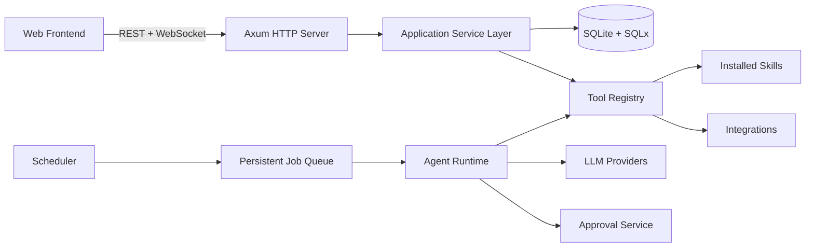

# Architecture Overview

Auren-AI is a self-hosted platform that runs autonomous AI agents capable of executing persistent tasks, calling tools exposed by installed skills, and interacting with external services on the user's behalf.

## Components

- **HTTP server (Axum)**: serves the versioned REST API under `/api/v1`, health endpoints, and the authenticated WebSocket endpoint `/api/v1/events`.
- **Application service layer**: all state changes flow through shared services (`TaskService`, `SchedulerService`, `ApprovalService`, etc.). REST handlers, the conversational agent, and the scheduler call the same validated services; security logic is never duplicated.
- **Database**: SQLite accessed through SQLx with versioned SQL migrations. See [Database](../database/README.md).
- **Tool registry**: in-memory registry of validated tools from installed skills and built-in integrations. Declarative skills register without a server restart.
- **Scheduler and job queue**: persistent schedules create execution requests that are enqueued transactionally; workers claim jobs with leases. See [Scheduling](scheduling.md).
- **Agent runtime**: executes task runs step by step, invoking tools through the permission engine. See [Agent Runtime](agent-runtime.md).

## Trust boundaries

See [Security Model](security-model.md) for the full trust boundary and authorization model.

## Invariants

1. Every resource lookup enforces ownership and authorization.
2. All state changes are persisted before being reported as successful.
3. Uploaded skill code is never executed inside the main Axum process; the first release supports declarative skills only.
4. Credentials are stored with authenticated encryption; keys are kept separate from ciphertext.
5. Audit events are append-only and never contain secrets.