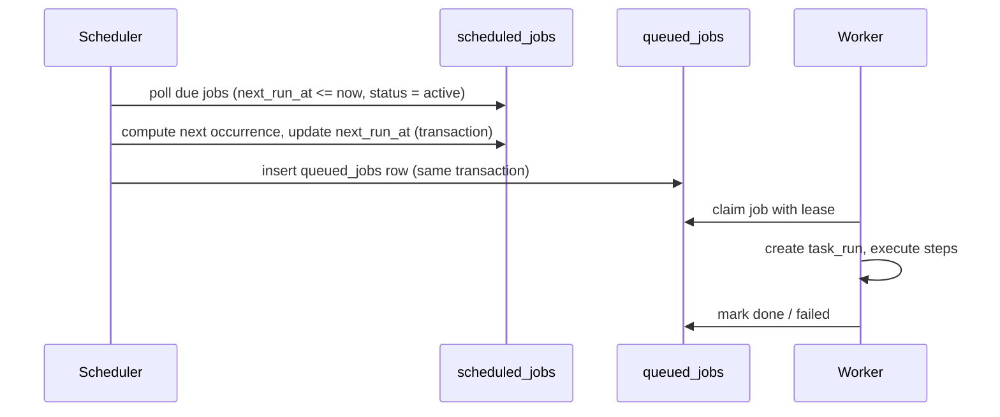

# Scheduling

## Model

- A recurring task has a persistent schedule stored in `tasks.schedule_json` and mirrored in `scheduled_jobs` (one row per task, enforced by a unique constraint).
- `scheduled_jobs.next_run_at` drives the scheduler; a partial index keeps the hot query small.

## Flow

## Duplicate prevention

The scheduler uses transactions plus uniqueness constraints to avoid duplicate enqueueing: the `scheduled_jobs` update and the `queued_jobs` insert happen in the same transaction, and a task has at most one active schedule row.

## Leases

Workers claim a job by transitioning it to `leased` with a `lease_expires_at` and `lease_owner`. A job whose lease expires is returned to `pending` on startup recovery or by a reaper. Attempts are counted in `attempt_count`; repeated failures eventually mark the job `failed`.

## Exactly-once caveat

External operations are not assumed to be exactly-once. When an operation's outcome is uncertain (for example, a timeout after the request was sent), the outcome is recorded and reconciled before any retry.