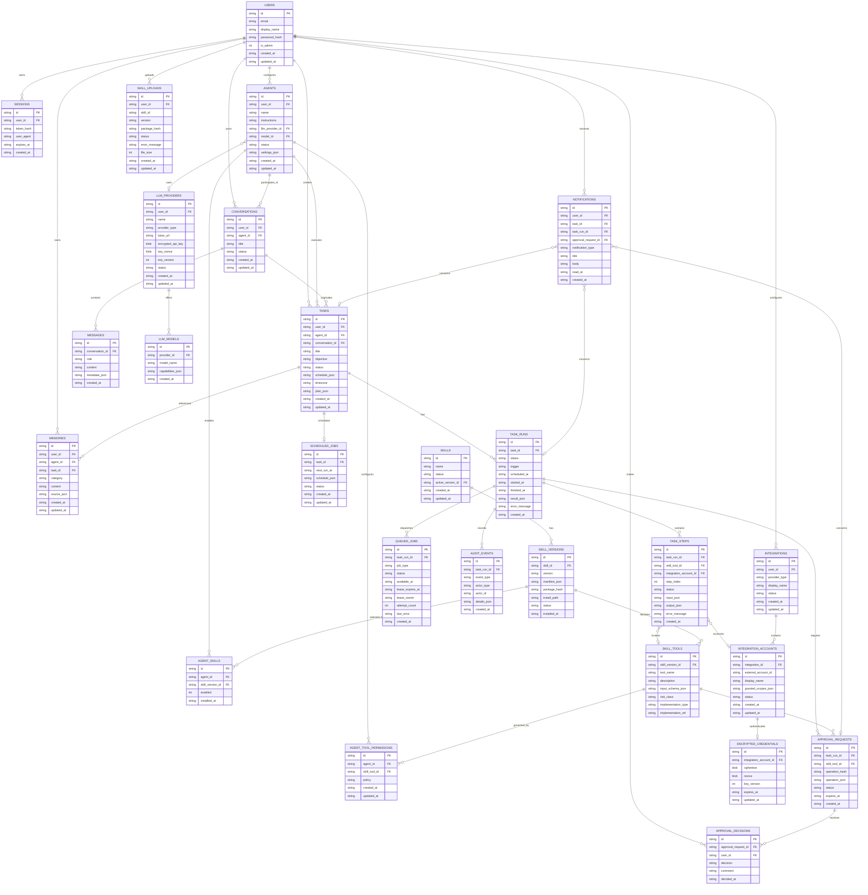

# ER Diagram

The authoritative logical data model. Physical types, indexes, constraints, and nullability are defined in the migrations and the [data dictionary](data-dictionary.md).

## Differences from the original specification diagram

- `USERS` includes `display_name` and `is_admin` to support the setup flow.
- `AGENTS` includes `settings_json`; `CONVERSATIONS` includes `status`; `MESSAGES` includes `metadata_json`.
- `TASK_RUNS` includes `trigger` to distinguish manual, scheduled, and retry runs.
- `TASK_STEPS` includes `error_message`.
- `QUEUED_JOBS` includes `job_type`, `lease_owner`, and `last_error` for lease-based claiming and reconciliation.
- `LLM_PROVIDERS` stores `key_nonce` and `key_version` alongside `encrypted_api_key` (authenticated encryption metadata) and a `status`.
- `SKILL_TOOLS` includes `implementation_ref` for declarative references to registered tools.
- `SKILL_UPLOADS` was added to persist the installation state machine (spec section 6).
- `APPROVAL_DECISIONS` has a unique constraint on `approval_request_id` so a single decision cannot be applied to unrelated operations.