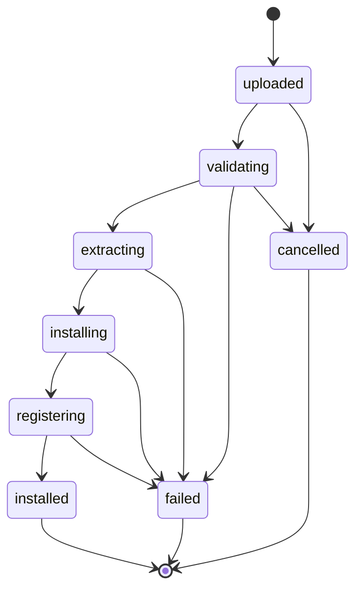

# Skill Installation Lifecycle

## State machine

Installation progress is persisted in the `skill_uploads` table and exposed through `GET /api/v1/skills/uploads/{upload_id}` and WebSocket events.

`installed` is reached only after validation, persistence, and runtime registration all succeed. Success is never reported while the skill is only partially installed.

## WebSocket events

| Event | Emitted when |
|---|---|
| `skill.upload_started` | An upload begins processing |
| `skill.validation_completed` | Package validation finishes |
| `skill.installed` | Installation and registration succeed |
| `skill.installation_failed` | Installation fails |

## Pipeline stages

1. **Upload** — authenticated endpoint; maximum compressed size, request timeout, rate limits, temporary storage quotas, authorization checks. An upload identifier is assigned and the initial state recorded.
2. **Archive validation** — ZIP structure, compression method, absolute paths, `..` traversal, symlinks, duplicate paths, entry count, total and per-file size, compression ratio, executable artifacts. The archive is untrusted input.
3. **Extraction** — into a unique temporary directory; every file's resolved destination is verified; the process cannot overwrite application code, credentials, the database, or other skills.
4. **Manifest and schema validation** — syntax, schema version, identifier, version, required files, tool definitions, JSON schemas, dependencies, minimum app version, required integrations, declared permissions. Invalid manifests are rejected; invalid tool definitions are never silently ignored.
5. **Capability and permission validation** — each declared tool must map to a supported implementation; requested capabilities must be compatible with the security policy; a skill cannot register an arbitrary URL as a trusted tool implementation or redefine a privileged tool; unsupported executable implementations are rejected.
6. **Installation** — package hash computed; installed into `/data/skills/<skill-id>/<version>/`; files immutable after validation; metadata, version, hash, path, and tools persisted in a transaction with atomic filesystem activation. On failure the previous active version is preserved and temporaries cleaned.
7. **Runtime registration** — skill and validated tool definitions registered in the in-memory registry, visible in the frontend, enableable by agents; integrations and permissions resolved at execution time. No server restart required for declarative skills.
8. **Completion** — upload marked `installed` only after registration succeeds; failures are recorded with a meaningful error.

## Idempotency and duplicates

Re-uploading the same package compares identifier, version, and package hash. Duplicate versions are handled explicitly instead of silently overwriting an active version. Installation history is recorded as audit events for administrative review.

## Safe updates

When a newer version of an installed skill is uploaded:

1. Validate it independently through the same pipeline.
2. Install it into a new version directory.
3. Register and verify its definitions.
4. Activate it only after successful validation, updating the active version transactionally with an atomic filesystem swap.
5. Preserve the previous version for rollback.

If the new version is invalid, the previous active version remains unchanged.

## Removal policy

- Disable the skill first; new tool invocations are blocked immediately.
- For running tasks, apply an explicit policy: already-authorized safe steps may finish or the task is cancelled. A disabled skill never silently initiates new operations.
- Remove the active registration, apply the retention policy to historical metadata, and delete package files only when no longer required.
- Uninstalling never deletes unrelated files.